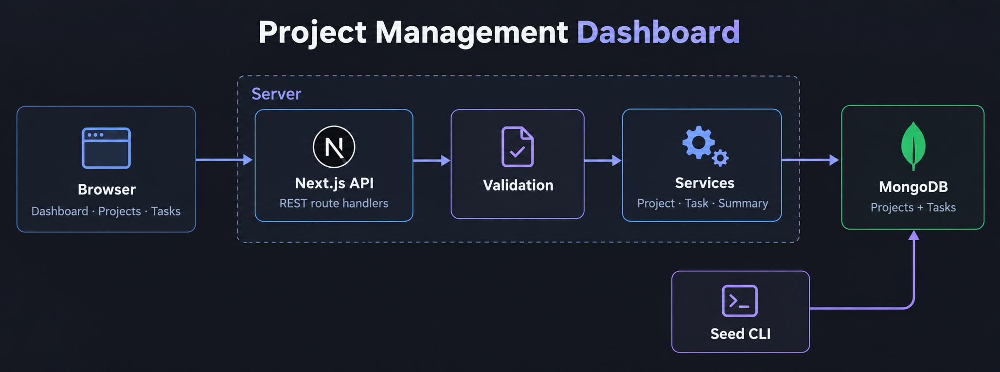
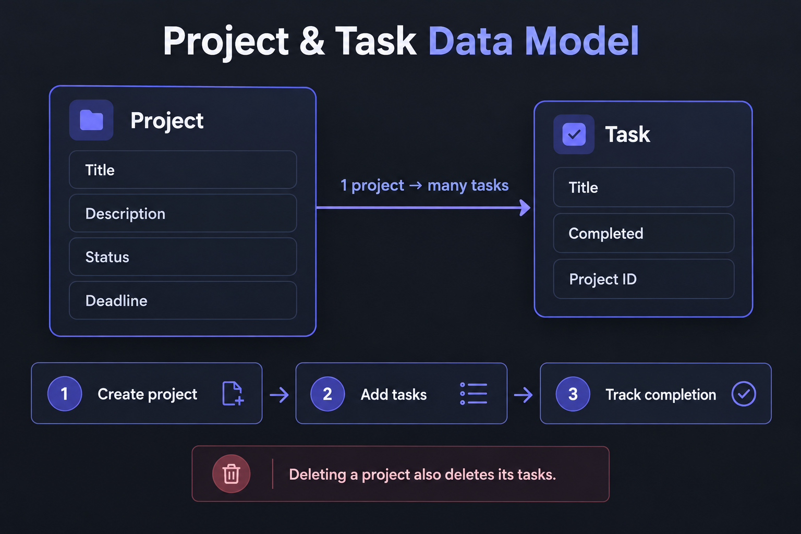
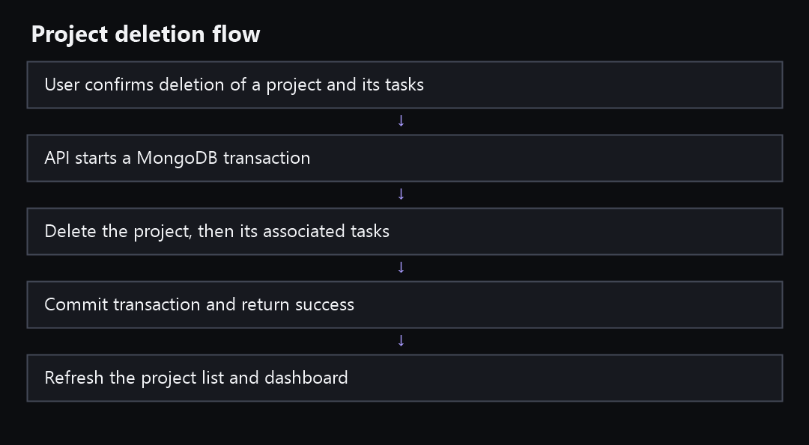

# Architecture and decisions

**Status:** source implements the initial modular monolith; lint, type check and an optimized Webpack build pass. Runtime database behavior, Atlas connection and deployment have not been verified. The [assessment](../EnvisionStudio%20%E2%80%93%20Web%20Developer%20Practical%20Assessment.md) defines required behavior; this page records current implementation boundaries and tradeoffs.

## System overview

Request path: Browser UI → same-origin Next.js Route Handlers → Zod and HTTP guards → project/task services → MongoDB. Services return DTOs through the API to the browser. The operator-run seed CLI validates the fixture and connects directly to MongoDB.

The frontend uses same-origin REST calls for every application data operation. Dashboard metrics (`/api/dashboard`) and recent projects (`/api/projects?limit=5`) use independent React Query requests, so the cards and project table render as soon as each response arrives. Route Handlers own HTTP parsing, input validation, response status and error conversion. Services own database queries and relationship rules. Mongoose models own field constraints and indexes. UI components own rendering and mutation feedback.

## Source boundaries

- App Router pages and API Route Handlers live under src/app. All API handlers use the Node.js runtime because Mongoose does not run on Edge.
- Browser components live under src/components. API fetch helpers live under src/lib/client. Browser-safe contracts live under src/lib/shared and do not import database code.
- Mongo connection and schemas live under src/lib/db. Service, HTTP and cursor modules live under src/lib/server and are marked server-only.
- The seed CLI imports the database core directly because server-only is a Next.js boundary marker, not a general Node runtime guard.
- ESLint blocks src/components, src/lib/client and src/lib/shared from importing privileged database or server modules. Keep imports one-way: UI → client/shared; routes → server services/shared; services → database/shared.
- Code/config files are limited to 250 physical lines; scripts/check-line-limits.mjs enforces this locally.

This is a modular monolith: one deployable Next.js app and one independently managed MongoDB database. Microservices, queues and distributed caches have no demonstrated need in this assessment.

## Data relationship and consistency

A project has its own document. Each task stores its parent project ObjectId, title, optional description, source status and completion boolean. The seed adapter joins the fixture's top-level tasks to projects by `projectId`. Task APIs require both IDs, preventing a task from being changed through another project's URL. Project deletion and task creation use transactions so concurrent writes cannot leave orphan tasks. Task creation increments an internal parent write-version without changing the project's visible updatedAt.

Transactions require Atlas or another replica-set MongoDB. They must be exercised in the target database before release. Callback operations are sequential and have no external side effects because the driver may retry them. The write-version serializes task creation with project deletion. Concurrent edits remain last-write-wins; this demo has no multi-user conflict resolution.

## Request flow and defensive boundaries

1. Browser form validates for user feedback, then sends JSON to a same-origin endpoint.
2. Mutation endpoints require an Origin header matching the configured exact-origin allowlist. Input schemas reject unknown fields. The server streams at most 16 KiB and limits list pages.
3. IDs and task ownership are checked before query or mutation. Services return explicit DTOs, not Mongoose documents.
4. API errors return safe messages and request IDs; logs contain error category/type only. Responses are no-store.
5. Mongo credentials remain in server environment variables. Security headers are set in Next config; production adds HSTS.
6. No authentication, authorization or application-level rate limiter exists. Origin validation helps block cross-site browser writes but does not prevent a direct caller from forging Origin. Use non-sensitive isolated data and hosting-level abuse controls.

## Decisions and tradeoffs

| Decision | Reason | Tradeoff or revisit |
| --- | --- | --- |
| Next.js App Router, TypeScript and Tailwind CSS | One allowed full-stack stack with built-in APIs | Verify deployment uses the Node runtime |
| Webpack for production builds | Turbopack's PostCSS worker could not start in the restricted workspace; Webpack build passed when the process had filesystem write access, while sandboxed runs may return EPERM creating `.next` output | Supported Next build option; revisit when the target build environment can run Turbopack reliably |
| MongoDB Atlas and Mongoose | User selected MongoDB and assessment allows it | Multi-document integrity requires transactions |
| Same-origin REST plus React Query | Clear API boundary and refresh after mutations | Query invalidation needs discipline |
| Separate Project and Task collections | Matches assessment models and scoped task lists | Transaction-capable cluster needed |
| Cursor pagination with compound indexes | Avoids unbounded project/task list reads | Not a snapshot under concurrent writes |
| Explicit seed CLI with checksum manifest | Controlled repeatable initial import | The supplied fixture maps and normalizes locally; database import, stored counts and relationships remain unverified |
| Public demo without sign-in | Removes reviewer onboarding friction | Anyone can modify shared records; not suitable for real agency work |
| Dark charcoal, violet accent, 4px corners | Matches user direction and dark-theme preference | Contrast and responsive layout still need browser review |
| No charts, collaboration or search | Outside the assessment's fixed feature set | Add only after requirements are defined |

## Keeping the design accurate

Update this document and the diagrams if source behavior changes. Distinguish source decisions from runtime facts. The generated illustrations are conceptual; field names in the actual models and API guide are authoritative.
