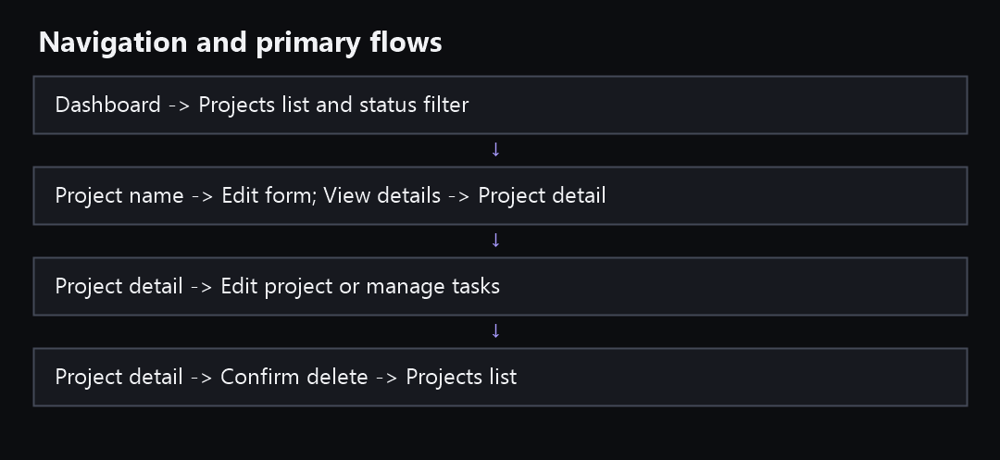

# UX and design handoff

**Status:** screens and responsive styling are present in source. Browser rendering, contrast, keyboard, screen-reader and mobile behavior have not been reviewed. The local [assessment](../EnvisionStudio%20%E2%80%93%20Web%20Developer%20Practical%20Assessment.md) remains the behavior source of truth.

## Design references

- [Ronas IT project-management case study](https://ronasit.com/cases/saas-management-case/) — project list, task panels, dashboard and UI-kit imagery for hierarchy and workflow inspiration.
- [Yowk project dashboard](https://dribbble.com/shots/27604088-Yowk-co-Project-Management-Dashboard) — concise dashboard metric-card inspiration.
- [One Admin dark dashboard](https://raselhossain.dev/projects/one-admin-dark-theme-admin-dashboard) — navigation and dense table inspiration.

These are references, not product assets. The application uses its own names, workflows and styling. It does not claim to implement collaboration, charts or features visible in reference products.

## Visual system in source

- Charcoal canvas (#0C0D10), darker sidebar (#101116), panel surface (#17191F), restrained borders (#2A2D36), light text (#F1F2F5), muted text (#A9ADB8), violet accent (#A99BFF).
- Corners use a 4px radius, clear borders and a compact 4/8px spacing rhythm.
- Status labels pair readable text with color and a marker, so color is not the only signal.
- Original local CSS styles are used with Tailwind CSS/PostCSS integrated in the project. Typography and responsive rules are in src/app/styles.

Check real rendered text and component contrast against WCAG before release. Small metadata text is intentionally subdued but must remain readable. No visual browser review has yet confirmed the current tokens.

## Navigation and primary flows

- Dashboard shows four required metrics and five recent database records; a new-project action opens the project form.
- Projects page offers status filtering, paginated rows on desktop and cards on small screens. Clicking the project title or Edit opens the prefilled edit dialog. View details is a separate link.
- Project detail shows full project data and paginated tasks, including fixture descriptions and statuses. Users can create, edit, delete and toggle tasks, edit project fields, or confirm deletion.
- Mobile navigation is exposed through a menu control. The global mobile create action appears on the dashboard; the Projects page uses its page-level create button to avoid duplicate actions.

## Screen states implemented

| Screen | Main content | Source states |
| --- | --- | --- |
| Dashboard | Counts and recent projects | Initial skeleton, API error/retry, empty workspace |
| Projects | Filter, rows/cards, actions and pagination | Loading, API error/retry, no projects, no filter matches |
| Project detail | Full project information and task list | Loading, API error/retry, no tasks, task update error |
| Project/task dialogs | Validated labelled fields and submit state | Client validation, server field errors, save failure, saving |
| Confirm dialog | Record and cascade consequence | Cancel, pending delete, failure |

Errors preserve form input. A successful mutation refreshes affected project/task/dashboard query data. Empty states direct the reviewer to create records or clear a filter.

## Accessibility and responsive implementation notes

The source uses semantic navigation, headings, buttons and links; native dialog elements with labelled title/description, Escape dismissal and focus behavior; labelled form controls; visible focus outlines; reduced-motion CSS; and a mobile drawer hidden from keyboard/screen-reader navigation while closed. Project and task actions remain visible without hover. Review these behaviors in a browser because implementation presence alone does not confirm accessibility.

At widths below 760px the sidebar becomes a drawer, the header gains menu/create controls, project tables switch to cards, content stacks, and task actions remain available. Below 400px spacing contracts. Long project titles wrap on the detail page. Verify on real narrow viewports and with keyboard/screen reader before release.
